# BPM Simulation of a Mesoscale Photonic Nanojet Generator

**Author:** Joshua Dakim Solomon
**Course:** Electromagnetic Modelling of Micro-Nano Structured Surfaces (J.-P. Colombier), Université Jean Monnet, Saint-Étienne
**Date:** November 2026
**Language:** MATLAB (also runs in GNU Octave 8)

This project uses the paraxial **beam propagation method (BPM)** with a Fourier split-step scheme. It has two parts:

1. **Part 1 – thin lens.** A Gaussian beam is focused by an ideal thin lens and the result is checked against Gaussian-beam theory. This validates the BPM code.
2. **Part 2 – photonic nanojet.** The focused beam illuminates a fused-silica microcylinder in water. The cylinder concentrates the light into a narrow, intense beam behind it, called a *photonic nanojet*. The jet is characterised, validated against the exact Mie solution, checked for numerical convergence, studied as a function of index contrast and size, and improved with a core–shell design.

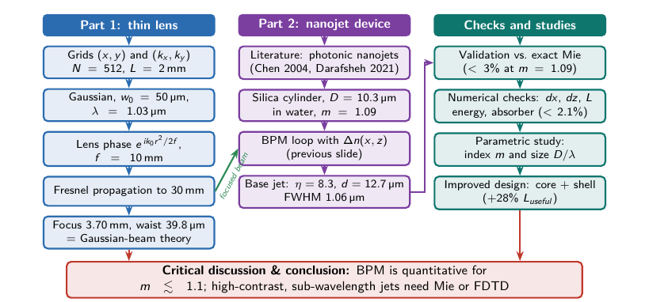

### Main results

| | Result |
|---|---|
| Part 1: focus position (BPM / theory) | 3.70 mm / 3.68 mm |
| Part 1: waist at the focus (BPM / theory) | 39.8 µm / 39.8 µm |
| Part 2: jet distance behind the cylinder | 12.7 µm (ray optics predicts 25.0 µm) |
| Part 2: peak enhancement | 8.3 × incident intensity |
| Part 2: jet width (FWHM) | 1.06 µm = 1.36 λ/n |
| Part 2: jet length above half maximum | 13.6 µm = 17.5 λ/n |
| Agreement with the exact Mie solution (silica in water) | within 3 % |
| Numerical convergence (grid, step, window) | within 2.1 % |
| Improved design (silica core + low-index shell) | 28 % longer useful jet, 92 % of the peak intensity |

---

## Contents

1. [Repository structure and how to run](#1-repository-structure-and-how-to-run)
2. [Theory: the paraxial beam propagation method](#2-theory-the-paraxial-beam-propagation-method)
3. [Part 1: Gaussian beam focused by a thin lens](#3-part-1-gaussian-beam-focused-by-a-thin-lens)
4. [Part 2: the photonic nanojet device](#4-part-2-the-photonic-nanojet-device)
5. [Base case results](#5-base-case-results)
6. [Validation against the exact Mie solution](#6-validation-against-the-exact-mie-solution)
7. [Numerical checks](#7-numerical-checks)
8. [Parametric study: index contrast and size](#8-parametric-study-index-contrast-and-size)
9. [Improved design: silica core with a low-index shell](#9-improved-design-silica-core-with-a-low-index-shell)
10. [Discussion: limits of the paraxial BPM](#10-discussion-limits-of-the-paraxial-bpm)
11. [Conclusion](#11-conclusion)
12. [Changes from the project proposal](#12-changes-from-the-project-proposal)
13. [References](#13-references)

---

## 1. Repository structure and how to run

```
bpm-photonic-nanojet/
├── README.md
├── code/
│   ├── BPM_focusing_lens.m          Part 1: thin lens (figures 1–7)
│   ├── BPM_nanojet_cylinder.m       Part 2: base case, index map, jet, cross-sections
│   ├── BPM_nanojet_movie.m          Part 2: movie of the propagation
│   ├── BPM_nanojet_validation.m     Part 2: comparison with the exact Mie solution
│   ├── BPM_nanojet_convergence.m    Part 2: grid, step, window and absorber checks
│   └── BPM_nanojet_parametric.m     Part 2: contrast, size and core-shell design
└── figures/                         images used in this README
```

All scripts follow the structure of the course code: parameters at the top in µm or mm (converted to SI on the same line), axes built in `for` loops, the split-step loop with comments for each step, and the results printed without a semicolon.

| Script | What it does | Run time |
|---|---|---|
| `BPM_focusing_lens.m` | 2D (x, y) propagation of the beam focused by the lens, comparison with Gaussian-beam theory | ≈ 10 s |
| `BPM_nanojet_cylinder.m` | silica cylinder in water: index map, intensity map, on-axis intensity, cross-sections, figures of merit | ≈ 10 s |
| `BPM_nanojet_movie.m` | video of the propagation (runs the cylinder script first if needed) | ≈ 30 s |
| `BPM_nanojet_validation.m` | BPM vs. exact Mie series for four index contrasts | ≈ 15 s |
| `BPM_nanojet_convergence.m` | 12 runs varying dx, dz, window size and absorber | ≈ 40 s |
| `BPM_nanojet_parametric.m` | 28 runs: contrast sweep, size sweep, core–shell designs | ≈ 2–3 min |

Each script starts with `clear` and runs on its own. Open it in MATLAB and press **Run**. The movie script saves `nanojet_cylinder.mp4` (Windows/Mac) or `nanojet_cylinder.avi` (Linux).

---

## 2. Theory: the paraxial beam propagation method

### 2.1 From the Helmholtz equation to the paraxial equation

For a monochromatic wave in a medium with index $n(x,y,z)$, the field satisfies the Helmholtz equation

$$
\frac{\partial^2 E}{\partial x^2}+\frac{\partial^2 E}{\partial y^2}+\frac{\partial^2 E}{\partial z^2}+k^2(x,y,z)\,E=0,
\qquad k(x,y,z)=k_0\,n(x,y,z),\qquad k_0=\frac{2\pi}{\lambda}.
$$

The fast oscillation along $z$ is separated from a slowly varying envelope $u$:

$$
E(x,y,z)=u(x,y,z)\,e^{-j\beta z},\qquad \beta=k_0 n_0 ,
$$

where $n_0$ is a reference index. Substituting gives

$$
-\frac{\partial^2 u}{\partial z^2}+2j\beta\frac{\partial u}{\partial z}=\nabla_t^2 u+(k^2-\beta^2)\,u .
$$

With the **slowly varying envelope approximation** $\left|\partial^2 u/\partial z^2\right| \ll \left|2\beta\,\partial u/\partial z\right|$, the second derivative is dropped and the **paraxial equation** follows:

$$
\frac{\partial u}{\partial z}=\hat D u+\hat W u,\qquad
\hat D=\frac{1}{2j\beta}\nabla_t^2,\qquad
\hat W=\frac{1}{2j\beta}\left(k^2-\beta^2\right).
$$

$\hat D$ describes diffraction and $\hat W$ describes the effect of the medium. Dropping $\partial^2 u/\partial z^2$ also removes backward waves (no reflections) and limits the method to small propagation angles.

### 2.2 The index operator uses the vacuum wavenumber

Writing $n=n_0+\Delta n$ with $\Delta n \ll n_0$:

$$
k^2-\beta^2=k_0^2\left(n^2-n_0^2\right)\approx 2k_0^2\,n_0\,\Delta n
\quad\Rightarrow\quad
\hat W=\frac{2k_0^2 n_0\Delta n}{2jk_0 n_0}=-j\,k_0\,\Delta n .
$$

The phase added by the medium therefore uses the **vacuum** wavenumber $k_0=2\pi/\lambda$, while diffraction uses $\beta=k_0 n_0$. The project sheet writes the index term with $k_0=2\pi n_0/\lambda$, which is only correct for $n_0=1$ (air). In water ($n_0 = 1.326$) it would overstate the cylinder's phase by 33 %, so the code keeps the two wavenumbers separate:

$$
k_{bg}=\frac{2\pi n_{bg}}{\lambda}\ \text{(diffraction)},\qquad k_0=\frac{2\pi}{\lambda}\ \text{(index step)}.
$$

### 2.3 Split-step solution

If the operators are treated as independent over one step $\Delta z$, the Baker–Hausdorff formula gives

$$
u(z+\Delta z)=e^{(\hat D+\hat W)\Delta z}\,u(z)\approx e^{\hat W\Delta z}\,e^{\hat D\Delta z}\,u(z),
$$

with an error coming from the commutator $[\hat D,\hat W]$, largest where $\Delta n$ changes sharply.

**Diffraction in Fourier space.** With the 2D Fourier transform

$$
\tilde u(k_x,k_y,z)=\iint u(x,y,z)\,e^{-j(k_x x+k_y y)}\,dx\,dy ,
$$

the operator $\partial^2/\partial x^2+\partial^2/\partial y^2$ becomes $-(k_x^2+k_y^2)$, and one step is a multiplication by the **transfer function**

$$
H(k_x,k_y,\Delta z)=\exp\!\left[\,i\,\frac{(k_x^2+k_y^2)\,\Delta z}{2k_{bg}}\right].
$$

**Index in real space.** The medium step is a multiplication by $e^{-ik_0\Delta n\,\Delta z}$. One complete step is therefore

$$
\psi(x,y,z+\Delta z)=\exp\!\left[-ik_0\,\Delta n(x,y,z)\,\Delta z\right]\;
\mathcal F^{-1}\!\left\{H(k_x,k_y,\Delta z)\;\mathcal F\{\psi(x,y,z)\}\right\}.
$$

Both factors have modulus 1, and the FFT conserves energy (Parseval), so without absorption the scheme conserves

$$
E=\iint |\psi|^2\,dx\,dy
$$

exactly. This is used as a check in every script.

### 2.4 Discretisation

For $N$ samples over a window of width $L$:

$$
\Delta x=\frac{L}{N},\qquad
x_m=(m-1)\Delta x-\frac{L}{2},\qquad
k_{x,m}=\frac{2\pi(m-1)}{N\Delta x}-\frac{\pi}{\Delta x},\qquad
\Delta k=\frac{2\pi}{L},\qquad
k_{max}=\frac{\pi}{\Delta x}.
$$

$\Delta x$ sets the finest detail the simulation can see, $L$ sets how much room the beam has before it reaches the edges (the FFT makes the window periodic), and $k_{max}/k$ sets the steepest propagation angle the grid can represent. The frequency axis is centred, so `fftshift(H)` is used inside the loop, as in the course code.

---

## 3. Part 1: Gaussian beam focused by a thin lens

Parameters: $w_0 = 50\ \mu\text{m}$, $\lambda = 1.03\ \mu\text{m}$, $f = 10$ mm, $Z_{max} = 30$ mm, in air.

### Step 1 – Spatial and frequency grids

$N = 512$ points over $L = 2$ mm, so $\Delta x = 3.9\ \mu\text{m}$, $\Delta k = 3.1\times10^3$ rad/m and $k_{max} = 8.0\times10^5$ rad/m.

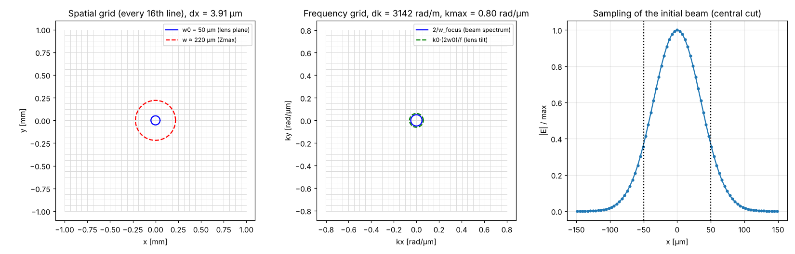

* **Left:** the spatial window. The beam at the lens (blue circle) and at 30 mm (red dashed circle) both stay far from the edges, so the field never wraps around.
* **Middle:** the frequency grid. Everything the beam needs (the focused spot's spectrum and the tilt added by the lens) is a small circle near the centre, far below $k_{max}$, so there is no aliasing. $k_{max}/k_0 \approx 0.13$, i.e. the grid represents angles up to about 7.5°, while the beam only uses about 0.5°.
* **Right:** about 25 samples across the initial beam diameter.

### Step 2 – Initial Gaussian field

$$
\psi(x,y,0)=\frac{1}{w_0\sqrt{\pi}}\exp\!\left(-\frac{x^2+y^2}{w_0^2}\right).
$$

The field is real, so the wavefront is flat: $z = 0$ is the beam waist. With this normalisation the energy is

$$
E_{ini}=\iint|\psi|^2\,dx\,dy=\frac{1}{\pi w_0^2}\cdot\frac{\pi w_0^2}{2}=0.5 .
$$

### Step 3 – Thin-lens phase mask

An ideal thin lens only changes the phase:

$$
t(x,y)=\exp\!\left[i\,\frac{k_0}{2f}\left(x^2+y^2\right)\right],\qquad
\psi_L(x,y)=\psi(x,y,0)\;t(x,y).
$$

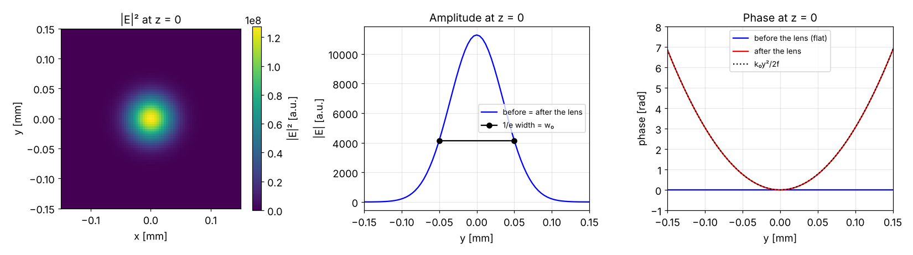

The amplitude is the same before and after the lens, with a 1/e half-width of 50.0 µm. Only the phase changes: flat before the lens, parabolic after it, exactly $k_0y^2/2f$. In this sign convention a phase $+k_0r^2/2f$ is a wave converging towards the axis.

### Step 4 – Energy conservation

`Energy_ini = 0.5000`, `Energy_pro = 0.5000`, relative error $7.6\times10^{-14}$. The lens and the transfer function are pure phases, so the energy is conserved to machine precision.

### Step 5 – Propagation with the Fresnel transfer function

The field after the lens is propagated over 300 steps of $\Delta z = 0.1$ mm with $H(k_x,k_y,\Delta z)$. Without an index term this step is exact for any $\Delta z$; the step size only sets how finely $z$ is sampled for the plots.

### Step 6 – Transverse intensity at the lens and at $Z_{max}$

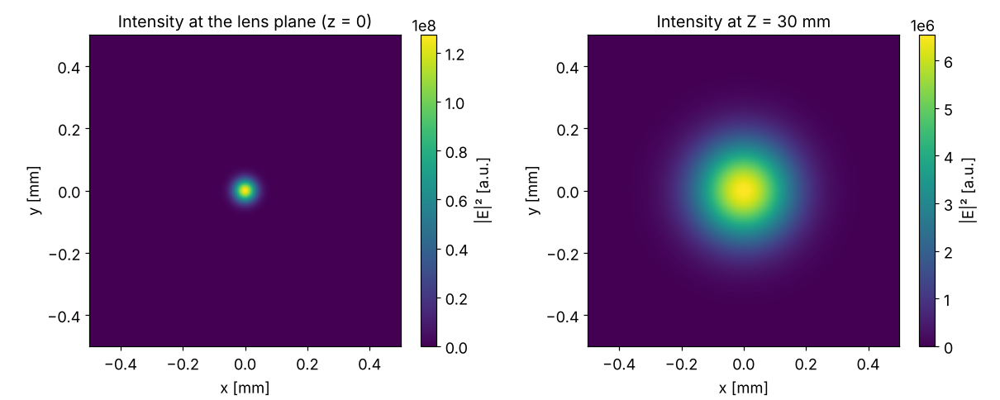

At 30 mm the beam is about 4.4 times wider than at the lens, so its peak intensity is about 20 times lower. The profile stays Gaussian: an ideal lens with no aperture only changes the width and the curvature.

### Step 7 – Beam width along z

The width is the 1/e half-width of the amplitude, found by linear interpolation between grid points. The reference is Gaussian-beam theory with the waist at the lens:

$$
z_R=\frac{\pi w_0^2}{\lambda},\qquad
d_f=\frac{f}{1+(f/z_R)^2},\qquad
w_f=\frac{w_0}{\sqrt{1+(z_R/f)^2}},\qquad
w(z)=w_f\sqrt{1+\left(\frac{z-d_f}{z_R'}\right)^2},\quad z_R'=\frac{\pi w_f^2}{\lambda}.
$$

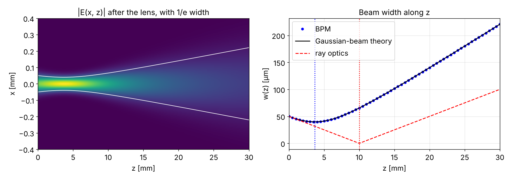

| | BPM | Theory |
|---|---|---|
| Focus position | 3.70 mm | 3.68 mm |
| Waist at the focus | 39.8 µm | 39.8 µm |
| Width at 30 mm | 220.7 µm | 220.7 µm |
| Largest deviation over 0–30 mm | 0.1 % | – |

**Comment.** The beam does not focus at $f = 10$ mm but at 3.7 mm. Its Rayleigh length ($z_R = 7.6$ mm) is close to $f$, so diffraction is as strong as the focusing and the waist moves towards the lens. Ray optics (red dashed line) predicts a point focus at 10 mm and is wrong here. The BPM reproduces Gaussian-beam theory to 0.1 % and conserves energy, so the code is ready for Part 2.

---

## 4. Part 2: the photonic nanojet device

### 4.1 Choice of device

A transparent sphere or cylinder a few wavelengths across, with a relative index $m=n_p/n_{bg}<2$, concentrates an incident wave into a narrow, intense, weakly diverging beam just behind its shadow side: the photonic nanojet [1–3]. Its position, width, length and peak intensity are set mainly by $m$ and by the size $D/\lambda$, and lower contrast gives longer, weaker jets [2, 3].

The simulated device:

* fused-silica cylinder, $D = 10.3\ \mu\text{m}$ ($D/\lambda = 10$), $n_p = 1.450$ at 1.03 µm [4];
* in water, $n_{bg} = 1.326$ [5], so $m = 1.09$;
* illuminated by the beam focused in Part 1, waist $w_0 = 39.8\ \mu\text{m}\approx 4D$, flat wavefront at the cylinder;
* 2D model in $(x,z)$, i.e. an infinite cylinder. The brief accepts a 2D version.

Water was chosen because a low index contrast keeps the paraxial BPM accurate, and immersed microparticles are common in nanojet applications such as microsphere-assisted microscopy [2].

### 4.2 The refractive index map Δn(x, z)

The cylinder is about 13 wavelengths thick in water, too thick for a thin phase mask (the light already starts converging inside it). Instead, the index map is built and applied slice by slice, sampled in the middle of each step:

$$
\Delta n(x,z)=
\begin{cases}
n_p-n_{bg} & \text{if } x^2+(z-z_c)^2\le R^2\\
0 & \text{otherwise}
\end{cases}
\qquad\Rightarrow\qquad
\psi \leftarrow \psi\,\exp\!\left[-ik_0\,\Delta n\!\left(x,z+\tfrac{\Delta z}{2}\right)\Delta z\right].
$$

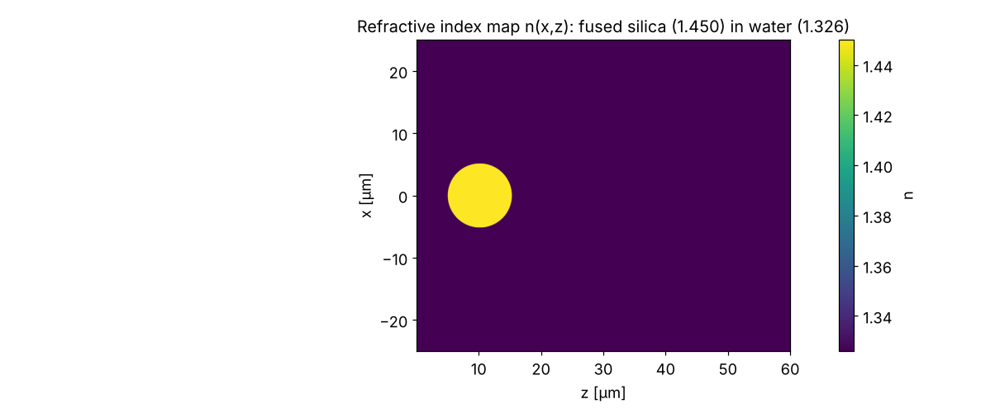

The front face of the cylinder is at $z = 5\ \mu\text{m}$, its centre at $z_c = 10.15\ \mu\text{m}$ and its shadow-side surface at $z_s = 15.3\ \mu\text{m}$.

### 4.3 The BPM loop

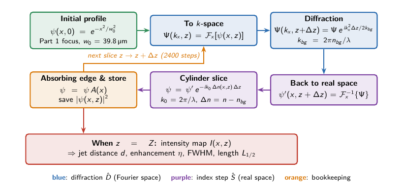

Grid: $N = 4096$ points over $L = 160\ \mu\text{m}$ ($\Delta x = 39$ nm), $\Delta z = 25$ nm, 2400 steps.

### 4.4 Absorbing boundary

The FFT window is periodic, so light scattered to large angles would re-enter from the other side. A graded absorber is applied in the outer 20 % of the window, defined per unit length so that its effect does not depend on the step size:

$$
A(x)=\exp\!\left[-\alpha\,\Delta z\left(\frac{\max(|x|-x_a,\,0)}{L/2-x_a}\right)^2\right],
\qquad x_a=0.8\,\frac{L}{2},\qquad \alpha=5\times10^5\ \text{m}^{-1}.
$$

The energy removed at each step is added up, so the balance $E_{ini}=E_{pro}+E_{abs}$ can be checked.

### 4.5 Figures of merit

Following the usual nanojet parameters [2]:

| Symbol | Definition |
|---|---|
| $d$ | distance from the shadow-side surface to the on-axis intensity maximum |
| $\eta$ | peak enhancement $I_{max}/I_0$, with $I_0$ the incident on-axis intensity |
| FWHM | full width at half maximum of the transverse intensity at the jet maximum |
| $L_{1/2}$ | axial length over which the on-axis intensity stays above $I_{max}/2$ |
| $L_{useful}$ | axial length over which $I > I_{max}/2$ **and** FWHM $< 2\lambda/n$ (used for the design, section 9) |

Widths and lengths are also given in units of the wavelength in water, $\lambda/n = 0.777\ \mu\text{m}$. As a simple reference, the paraxial ray-optics back focal length of a ball (or cylinder) lens is [2]

$$
d_{geo}=R\,\frac{2-m}{2(m-1)} .
$$

---

## 5. Base case results

### 5.1 Intensity map and on-axis intensity

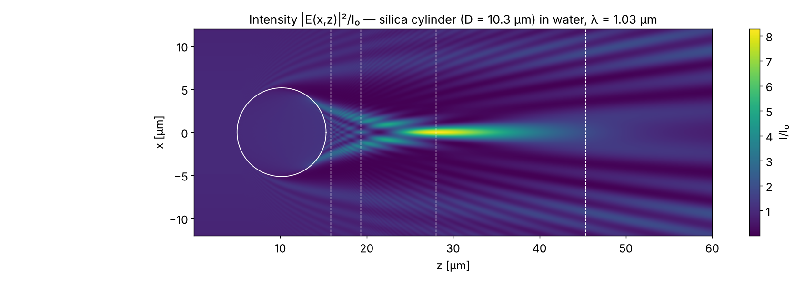

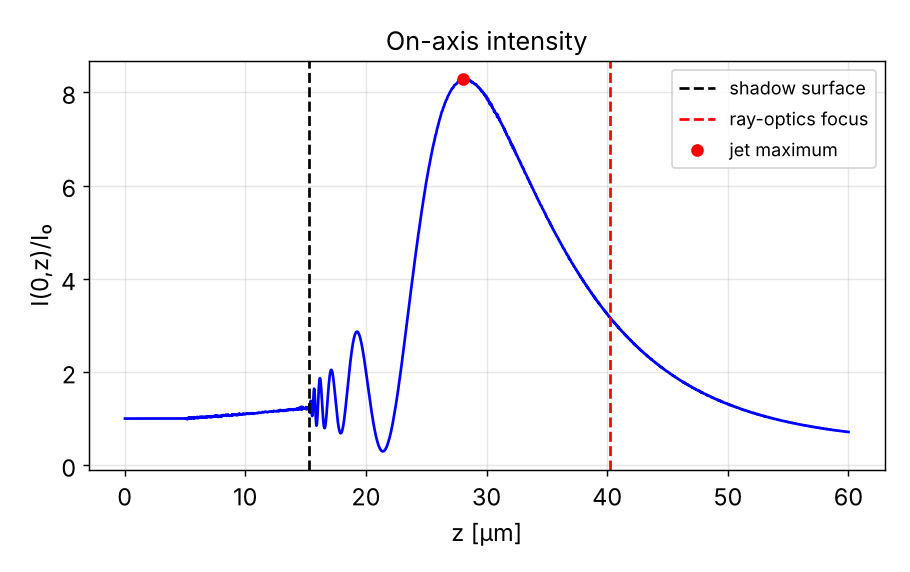

| $m$ | $d$ | $\eta$ | FWHM | $L_{1/2}$ | Energy absorbed | Energy balance |
|---|---|---|---|---|---|---|
| 1.0935 | 12.7 µm (ray optics 25.0 µm) | 8.28 | 1.06 µm = 1.36 λ/n | 13.6 µm = 17.5 λ/n | 0.14 % | $1.8\times10^{-13}$ |

**Observations.**

* Before the cylinder the intensity is uniform (the 40 µm beam looks like a plane wave over the ±15 µm shown).
* Inside the cylinder the intensity already rises slowly: focusing starts inside the particle.
* Just behind it there are short fringes and two side lobes, then one long, narrow jet peaking 12.7 µm behind the surface.
* The oblique fringes above and below come from light passing beside the cylinder interfering with light diffracted by its edges. The dark bands next to the jet are the cylinder's shadow: that light was redirected into the jet.

**Comment.** The jet peaks at about half the paraxial ray-optics distance. The whole cylinder is lit, and rays hitting it near the edge bend much more than central rays and cross the axis early (spherical aberration of a ball lens), which pulls the intensity maximum towards the cylinder. At this low contrast the jet is long (17.5 wavelengths in water) and about one wavelength wide, not sub-wavelength.

### 5.2 Transverse cross-sections

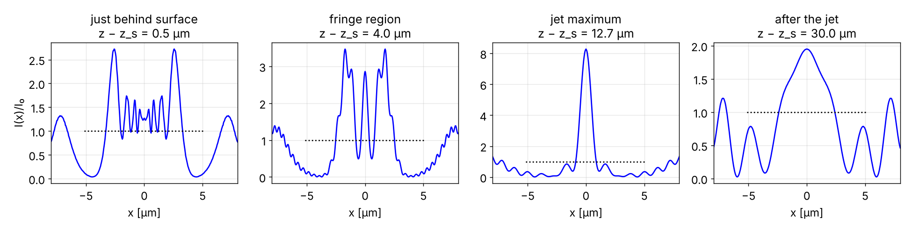

| Plane | What it shows |
|---|---|
| $z - z_s = 0.5$ µm | light converging at $x \approx \pm 2.5$ µm, with the shadow of the cylinder beside it |
| $z - z_s = 4$ µm | central and edge rays overlap and interfere (caustic) |
| $z - z_s = 12.7$ µm | one clean peak, $8.3\,I_0$, 1.06 µm wide |
| $z - z_s = 30$ µm | the jet spreads; the outer fringes come from light that passed beside the cylinder |

The dotted line is the incident level over the cylinder width. Away from the axis the intensity drops below 1: the jet takes its energy from there.

### 5.3 Movie of the propagation

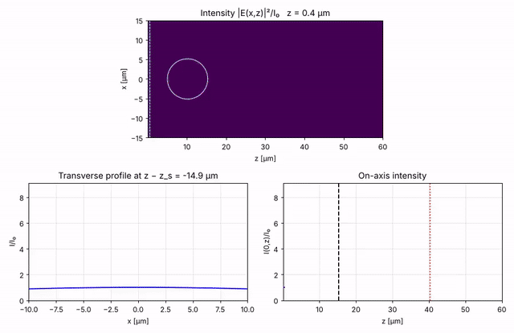

Generated with `BPM_nanojet_movie.m`: the intensity map is revealed slice by slice, with the transverse profile and the on-axis intensity below. The cross-section planes, the jet maximum and the $L_{1/2}$ region (magenta) appear as the beam reaches them, and the last frames show the final figures of merit.

---

## 6. Validation against the exact Mie solution

For an infinite dielectric cylinder lit by a plane wave with **E parallel to the cylinder axis** (the polarisation closest to a scalar model), Maxwell's equations have an exact series solution. With $x = k_{bg}R$ and $m = n_p/n_{bg}$, the field outside the cylinder is

$$
E(r,\varphi)=\underbrace{\sum_{n=-\infty}^{\infty} i^n J_n(k_{bg}r)\,e^{in\varphi}}_{e^{ik_{bg}z}}
+\sum_{n=-\infty}^{\infty} i^n a_n\,H_n^{(1)}(k_{bg}r)\,e^{in\varphi},
$$

where continuity of $E$ and $\partial E/\partial r$ at $r = R$ gives the coefficients

$$
a_n=\frac{m\,J_n'(mx)\,J_n(x)-J_n(mx)\,J_n'(x)}{J_n(mx)\,H_n^{(1)\prime}(x)-m\,J_n'(mx)\,H_n^{(1)}(x)} .
$$

The series is truncated at $n_{max} = x + 4x^{1/3} + 15$. The same figures of merit are extracted from the Mie field and from the BPM.

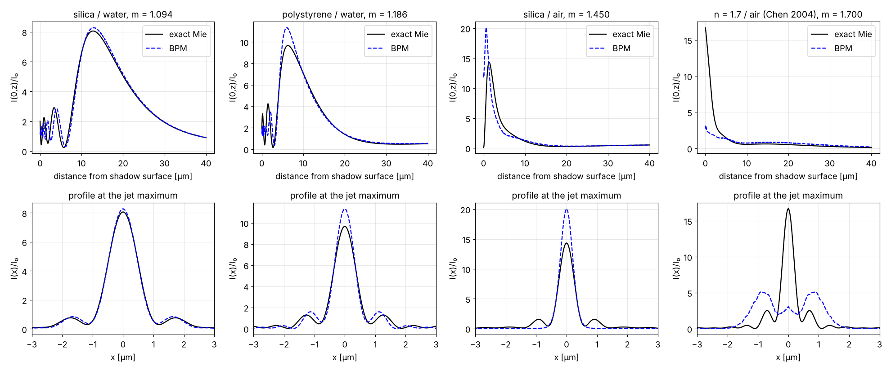

| Case | $m$ | $d$ (BPM / Mie) | $\eta$ (BPM / Mie) | FWHM in λ/n (BPM / Mie) |
|---|---|---|---|---|
| silica / water | 1.094 | 12.73 / 12.78 µm | 8.28 / 8.06 | 1.36 / 1.40 |
| polystyrene / water | 1.186 | 5.97 / 6.30 µm | 11.33 / 9.67 | 0.92 / 1.04 |
| silica / air | 1.450 | 0.63 / 1.35 µm | 20.08 / 14.33 | 0.46 / 0.54 |
| n = 1.7 / air | 1.700 | fails / 0.00 µm | 3.06 / 16.68 | 2.75 / 0.41 |

**Comments.**

* For the device (silica in water) the BPM agrees with the exact solution within 3 % on every figure of merit (−0.4 % in $d$, +2.8 % in $\eta$, −2.9 % in FWHM, −2.5 % in $L_{1/2}$).
* The agreement degrades as the contrast increases: the BPM jet becomes too strong and too close to the surface, and at $m = 1.7$ it fails completely.
* The last case reproduces the conditions of Chen et al. [1] ($n = 1.7$ in air, $D/\lambda = 10$). The Mie code gives a jet width of $0.41\lambda$, consistent with the $\approx 0.4\lambda$ they report, which also checks the Mie code.

---

## 7. Numerical checks

The base case was re-run while changing one numerical parameter at a time (`BPM_nanojet_convergence.m`).

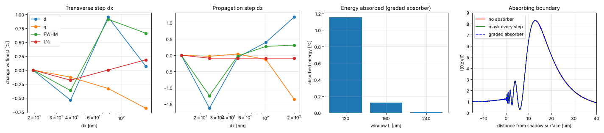

| Test | Range | Largest change in d / η / FWHM / L½ |
|---|---|---|
| Transverse step $\Delta x$ | 156 → 19.5 nm | ≤ 1.0 % / 0.7 % / 0.9 % / 0.2 % |
| Propagation step $\Delta z$ | 200 → 12.5 nm | ≤ 1.6 % / 1.3 % / 1.2 % / 0.1 % |
| Window $L$ | 120 → 240 µm | ≤ 1.5 % / 0.14 % / 1.2 % / 0 % |

* The chosen settings ($\Delta x = 39$ nm, $\Delta z = 25$ nm, $L = 160\ \mu\text{m}$) are within 1.6 % of the finest runs, below the 3 % difference with the exact solution, so the remaining error is physical, not numerical.
* The jet maximum is very flat, so $d$ moves by about ±0.2 µm with the pixelation of the cylinder edge: $d = 12.7 \pm 0.2\ \mu\text{m}$.
* The energy balance $E_{ini} = E_{pro} + E_{abs}$ closes to $10^{-13}$ in every run.
* **Absorber.** A first version applied a super-Gaussian mask at every step. Over 2400 steps its effect added up and it removed the tail of the incident beam well inside the window (1.35 % of the energy, strongly dependent on the window size). The graded absorber of section 4.4 removes 0.12 % without changing the jet. Without any absorber, 5 % of the peak field reaches the window edges.

---

## 8. Parametric study: index contrast and size

### 8.1 Relative index m (D = 10.3 µm)

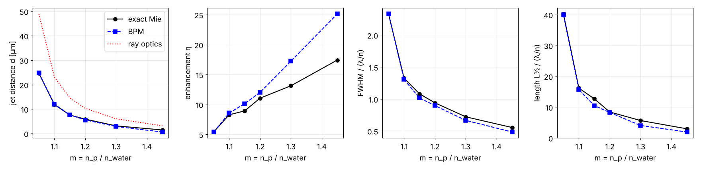

| $m$ | 1.05 | 1.10 | 1.15 | 1.20 | 1.30 | 1.45 |
|---|---|---|---|---|---|---|
| $\eta$ (BPM) | 5.4 | 8.6 | 10.1 | 12.0 | 17.2 | 25.1 |
| FWHM / (λ/n) | 2.33 | 1.31 | 1.02 | 0.90 | 0.67 | 0.48 |
| $L_{1/2}$ / (λ/n) | 39.9 | 15.6 | 10.5 | 8.2 | 4.0 | 1.9 |

**Comment.** Higher contrast brings the jet closer to the cylinder and makes it stronger, narrower and shorter, reaching about half a wavelength at $m = 1.45$. Up to $m \approx 1.1$ the BPM follows the exact solution; above, the trends stay correct but the BPM overestimates the intensity. The sweep stops at 1.45 for that reason.

### 8.2 Cylinder size D/λ (silica in water)

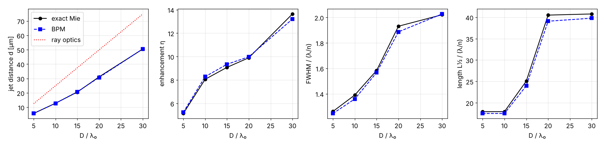

| $D/\lambda_0$ | 5 | 10 | 15 | 20 | 30 |
|---|---|---|---|---|---|
| $d$ (µm) | 5.7 | 12.7 | 20.8 | 30.7 | 50.5 |
| $\eta$ | 5.2 | 8.3 | 9.3 | 10.0 | 13.2 |
| FWHM / (λ/n) | 1.25 | 1.36 | 1.57 | 1.89 | 2.03 |
| $d/d_{geo}$ | 0.46 | 0.51 | 0.55 | 0.62 | 0.67 |

**Comment.** Bigger cylinders give a stronger but wider jet, further from the surface. The jet moves towards the ray-optics focus only slowly: spherical aberration is still important at $D = 30\lambda$. At this low contrast the BPM stays within 4.4 % of the Mie solution for every size, so size alone does not limit the method.

---

## 9. Improved design: silica core with a low-index shell

Layered and graded-index particles are known to produce longer nanojets [6, 7]. Here a silica core of radius $qR$ is surrounded by a shell of lower index $n_s$, keeping the outer diameter at 10.3 µm:

$$
\Delta n(x,z)=
\begin{cases}
n_{Si}-n_{bg} & \rho\le qR\\
n_s-n_{bg} & qR<\rho\le R\\
0 & \rho>R
\end{cases},
\qquad \rho=\sqrt{x^2+(z-z_c)^2}.
$$

The shell indices (1.35–1.42) are design values in the range of low-index polymers.

**Why a new length metric.** Measuring only $L_{1/2}$ favours designs whose jet is long but becomes wide (2.5–3 λ/n). The goal is a jet that is both long and narrow, so the design uses

$$
L_{useful}=\text{length of the axial region where } I>\frac{I_{max}}{2}\ \text{ and }\ \text{FWHM}(z)<2\,\frac{\lambda}{n}.
$$

Sixteen designs were simulated ($n_s$ = 1.35, 1.37, 1.40, 1.42 and $q$ = 0.4, 0.5, 0.6, 0.7). The improved design is the one with the longest $L_{useful}$ that keeps at least 90 % of the base peak intensity.

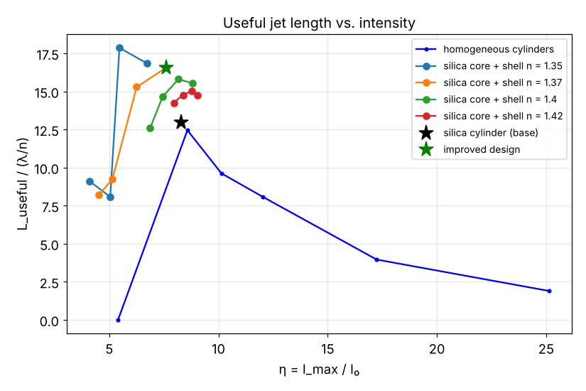

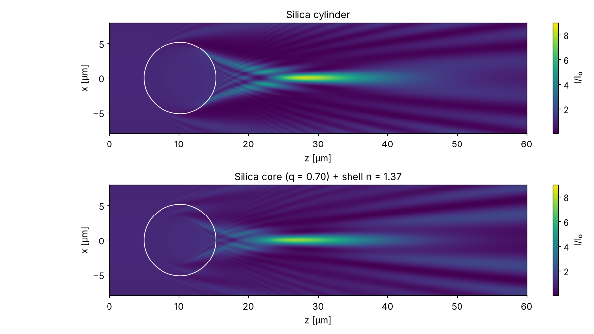

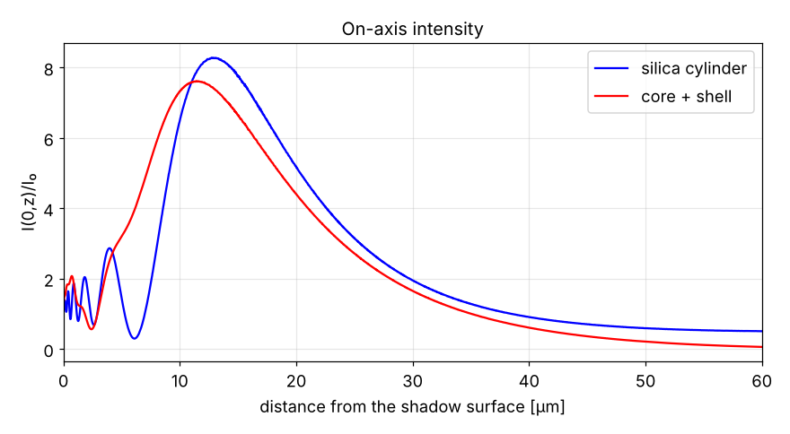

| Design | $\eta$ | $d$ | FWHM | $L_{useful}$ |
|---|---|---|---|---|
| Silica cylinder | 8.28 | 12.7 µm | 1.36 λ/n | 13.0 λ/n |
| Silica core ($q = 0.7$) + shell $n_s = 1.37$ | 7.62 | 11.4 µm | 1.46 λ/n | 16.6 λ/n |

**Comment.** The shell bends the edge rays less than solid silica would, so they do not focus as early and the jet stays narrow over a longer distance: $L_{useful}$ is 28 % longer for 8 % less peak intensity. All indices stay at $m \le 1.09$, inside the range where the BPM was validated.

---

## 10. Discussion: limits of the paraxial BPM

* **Index contrast.** The cylinder enters only as a phase $e^{-ik_0\Delta n\,\Delta z}$ and the split-step error grows at its sharp interface. The method is quantitative for $m \lesssim 1.1$ and gives only trends up to $m \approx 1.5$.
* **Propagation angles.** The paraxial transfer function makes a phase error of order $k\,\sin^4\theta\,\Delta z/8$ per step. At high contrast, rays near the edge of the cylinder leave it at large angles.
* **Reflections.** The BPM is one-way. Real Fresnel reflection at the two surfaces removes light near the rim, which the BPM instead sends into the focus. This is why the BPM jet is too strong and too close at high contrast.
* **Polarisation.** The model is scalar and matches the E-parallel-to-axis case. At high contrast the two polarisations give different jets.
* **Size and evanescent fields.** At low contrast, $D/\lambda$ from 5 to 30 is not a problem. At high contrast the jet touches the surface, where evanescent fields matter [8]; the BPM cannot represent them.
* **Model.** A 2D cylinder focuses in one direction only; a 3D sphere gives a stronger jet [9]. The pixelated cylinder edge limits the jet position to ±0.2 µm.

---

## 11. Conclusion

* The split-step BPM reproduces Gaussian-beam focusing by a thin lens to 0.1 %, including the shift of the focus from 10 mm to 3.7 mm.
* A 10.3 µm fused-silica cylinder in water forms a photonic jet 12.7 µm behind its surface, 8.3 times more intense than the incident light, 1.06 µm wide and 13.6 µm long.
* At this low contrast the BPM agrees with the exact Mie solution within 3 %, and the results are converged within 2 %.
* Higher contrast gives closer, narrower, stronger jets; bigger cylinders give stronger but wider jets further away.
* A silica core with a low-index shell gives a 28 % longer useful jet for 92 % of the intensity.
* The paraxial BPM is a fast design tool for low-contrast nanojet generators. Sub-wavelength jets at high contrast need full-wave methods (Mie theory, FDTD).

---

## 12. Changes from the project proposal

| Proposal | Final project | Reason |
|---|---|---|
| $m$ from 1.05 to 1.8 | $m$ from 1.05 to 1.45 | the validation shows the BPM is not reliable above that |
| several materials (silica, polystyrene, water, air) | fused silica in water, plus a sweep of $m$ | the contrast $m$ is the controlling parameter |
| validation with lens theory and published results | Gaussian-beam theory, exact Mie solution and Chen et al.'s case | stronger reference |
| core–shell and graded-index designs | core–shell only | the core–shell design targets the jet length directly |
| "longer jet at a narrow width" | $L_{useful}$ with FWHM $< 2\lambda/n$ | a long but wide beam should not count as a better jet |

---

## 13. References

1. Z. Chen, A. Taflove, V. Backman, "Photonic nanojet enhancement of backscattering of light by nanoparticles: a potential novel visible-light ultramicroscopy technique," *Opt. Express* **12**, 1214–1220 (2004).
2. A. Darafsheh, "Photonic nanojets and their applications," *J. Phys. Photonics* **3**, 022001 (2021). https://doi.org/10.1088/2515-7647/abdb05
3. J. Zhu, L. L. Goddard, "All-dielectric concentration of electromagnetic fields at the nanoscale: the role of photonic nanojets," *Nanoscale Adv.* **1**, 4615–4643 (2019). https://doi.org/10.1039/c9na00430k
4. I. H. Malitson, "Interspecimen comparison of the refractive index of fused silica," *J. Opt. Soc. Am.* **55**, 1205–1209 (1965).
5. G. M. Hale, M. R. Querry, "Optical constants of water in the 200-nm to 200-µm wavelength region," *Appl. Opt.* **12**, 555–563 (1973).
6. S.-C. Kong, A. Taflove, V. Backman, "Quasi one-dimensional light beam generated by a graded-index microsphere," *Opt. Express* **17**, 3722–3731 (2009).
7. Y. Shen, L. V. Wang, J.-T. Shen, "Ultralong photonic nanojet formed by a two-layer dielectric microsphere," *Opt. Lett.* **39**, 4120–4123 (2014).
8. A. Devilez, B. Stout, N. Bonod, E. Popov, "Spectral analysis of three-dimensional photonic jets," *Opt. Express* **16**, 14200–14212 (2008).
9. X. Li, Z. Chen, A. Taflove, V. Backman, "Optical analysis of nanoparticles via enhanced backscattering facilitated by 3-D photonic nanojets," *Opt. Express* **13**, 526–533 (2005).
10. J.-P. Colombier, *Electromagnetic Modelling of Micro-Nano Structured Surfaces*, lecture notes and project brief, Université Jean Monnet / Télécom Saint-Étienne.
