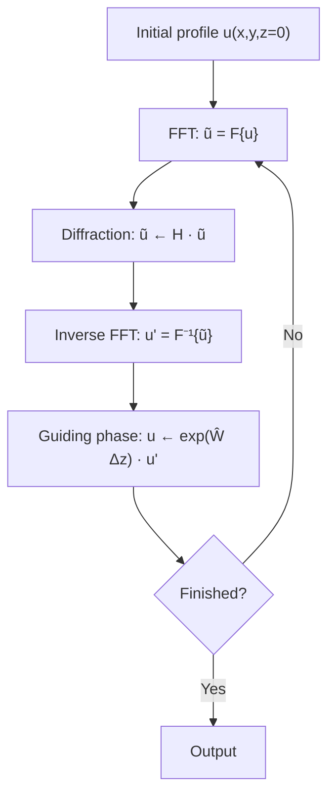

# Propagation of a 2D Gaussian Beam by the Paraxial Fourier Split-Step Beam Propagation Method (MATLAB)

A short MATLAB script (`Gauss.m`) that propagates a 2D Gaussian beam in free space using the **Beam Propagation Method (BPM)** with a **Fourier-transform split-step** scheme, under the **paraxial (Fresnel) approximation** of the Helmholtz equation.

This repository documents the physics behind the code, maps each line of the script to the corresponding equation, and records some numerical caveats worth knowing before extending it.

## Demo

<!--
  To embed the video so it plays inline on GitHub:
  edit this README in the GitHub web editor, drag-and-drop your video file here,
  and GitHub will insert a https://github.com/user-attachments/assets/... link.
-->

https://github.com/user-attachments/assets/REPLACE-WITH-YOUR-VIDEO-LINK

Fallback (video stored in the repo): [`media/gauss_bpm_simulation.mp4`](media/gauss_bpm_simulation.mp4)

The animation shows $|u(x,y,z)|$ after each propagation step: a pure diffraction process in which the Gaussian peak decreases and the beam widens.

## Repository contents

```
.
├── Gauss.m          # the simulation
├── media/           # simulation video / figures
├── README.md
├── LICENSE
└── .gitignore
```

## Quick start

1. Open MATLAB (GNU Octave also works for the numerics, though plotting may differ).
2. Set the current folder to this repository.
3. Run:

```matlab
Gauss
```

The script plots the initial beam, then runs 100 propagation steps and refreshes a 3D `mesh` plot of $|u|$ after each step (`pause(0.1)` sets the frame rate).

---

## 1. Physics

### 1.1 From the wave equation to the paraxial equation

For a monochromatic wave in a medium with spatially varying refractive index $\bar n(x,y,z)$, the scalar wave (Helmholtz) equation is

$$
\frac{\partial^2 E}{\partial x^2}+\frac{\partial^2 E}{\partial y^2}+\frac{\partial^2 E}{\partial z^2}+k^2(x,y,z)\,E=0,
\qquad k(x,y,z)=k_0\,\bar n(x,y,z),
$$

with $k_0 = 2\pi/\lambda$ the vacuum wavenumber.

The key assumption of BPM is that the fastest variation of the field is the oscillation along the propagation axis $z$. We therefore factor it out and write

$$
E(x,y,z)=u(x,y,z)\,e^{-j\beta z},
$$

where $u$ is a **slowly varying envelope** and $\beta$ is the **propagation constant** (the average phase advance per unit length). Substituting into the Helmholtz equation gives

$$
-\frac{\partial^2 u}{\partial z^2}+2j\beta\frac{\partial u}{\partial z}
=\frac{\partial^2 u}{\partial x^2}+\frac{\partial^2 u}{\partial y^2}+\left(k^2-\beta^2\right)u .
$$

**Slowly-varying-envelope approximation (SVEA).** If the envelope changes slowly over a wavelength along $z$,

$$
\left|\frac{\partial^2 u}{\partial z^2}\right|\ll\left|2\beta\frac{\partial u}{\partial z}\right| ,
$$

and the second $z$-derivative can be dropped (the *Fresnel* / *paraxial* approximation). This yields the **paraxial propagation equation**:

$$
2j\beta\frac{\partial u}{\partial z}=\frac{\partial^2 u}{\partial x^2}+\frac{\partial^2 u}{\partial y^2}+\left(k^2-\beta^2\right)u .
$$

> The scalar paraxial equation does not describe polarization effects, and it is only valid for beams propagating close to the $z$ axis.

### 1.2 Diffraction and guiding operators

Rewriting the equation as an evolution equation in $z$:

$$
\frac{\partial u}{\partial z}=\left(\hat D+\hat W\right)u ,
$$

with

$$
\hat D=\frac{1}{2j\beta}\left(\frac{\partial^2}{\partial x^2}+\frac{\partial^2}{\partial y^2}\right),
\qquad
\hat W=\frac{1}{2j\beta}\left(k^2-\beta^2\right).
$$

- $\hat D$ describes **free-space propagation (diffraction)**.
- $\hat W$ describes **guiding effects** (refractive-index variations).

Writing $\beta=k_0 n_{\mathrm{eff}}$ and $\bar n=n_{\mathrm{eff}}+\Delta n$, and keeping the first order in $\Delta n$ (so that $k^2-\beta^2\approx 2\beta k_0\Delta n$):

$$
\hat W=-j\,k_0\,\Delta n .
$$

### 1.3 Split-step solution

If $\hat D$ and $\hat W$ do not depend on $z$ over a step $\Delta z$, the formal solution is

$$
u(x,y,z+\Delta z)=e^{(\hat D+\hat W)\Delta z}\,u(x,y,z).
$$

Using the Baker–Campbell–Hausdorff formula, $e^{\hat A}e^{\hat B}=e^{\hat A+\hat B}\,e^{\frac12[\hat A,\hat B]}$ (valid when $\hat A$ and $\hat B$ commute with $[\hat A,\hat B]$), the exponential is **split** into two successive operations:

$$
u(x,y,z+\Delta z)\approx e^{\hat D\Delta z}\,e^{\hat W\Delta z}\,u(x,y,z).
$$

The splitting is exact when $[\hat D,\hat W]=0$, which is the case when $\Delta n$ is uniform in space, as in this script. For a spatially varying $\Delta n(x,y)$ the error per step is of order $\Delta z^2$.

### 1.4 The diffraction step is diagonal in Fourier space

Define the 2D Fourier transform

$$
\tilde u(k_x,k_y,z)=\iint u(x,y,z)\,e^{-j(k_x x+k_y y)}\,dx\,dy
\equiv\mathcal F_{x,y}\{u\},
$$

so that $\partial_x\to jk_x$ and $\partial_y\to jk_y$. The diffraction-only equation $2j\beta\,\partial_z u=\nabla_\perp^2 u$ becomes an ordinary differential equation for each Fourier component:

$$
2j\beta\frac{\partial\tilde u}{\partial z}=-\left(k_x^2+k_y^2\right)\tilde u .
$$

Integrating from $z$ to $z+\Delta z$:

$$
\tilde u(k_x,k_y,z+\Delta z)=\underbrace{\exp\!\left[\,j\,\frac{\Delta z}{2\beta}\left(k_x^2+k_y^2\right)\right]}_{\hat H(k_x,k_y,\Delta z)}\ \tilde u(k_x,k_y,z).
$$

$\hat H$ is the **transfer function of free space** in the paraxial approximation. It is a pure phase: each plane-wave component keeps its amplitude but acquires a $k$-dependent phase, and the interference of these dephased components is what makes the beam spread.

### 1.5 The guiding step

In real space the guiding step is a simple multiplication by a phase factor:

$$
u(x,y,z+\Delta z)=e^{\hat W\Delta z}\,u'(x,y,z+\Delta z)=e^{-j k_0 \Delta n\,\Delta z}\,u'(x,y,z+\Delta z).
$$

For a uniform $\Delta n$ this is a global phase and has **no effect on $|u|$**.

### 1.6 Algorithm



---

## 2. Code walkthrough

### 2.1 Parameters

| Variable | Value | Meaning |
|---|---|---|
| `N` | 10 | Samples per unit length |
| `delta_x` | `1/N` = 0.1 | Grid spacing $\Delta x=\Delta y$ |
| `minmax` | 10 | Half-width of the computational window, $x,y\in[-10,10]$ |
| `delta_z` | 5.0 | Propagation step $\Delta z$ |
| `beta` | 20 | Propagation constant $\beta$ |
| `k_zero` | 100 | Vacuum wavenumber $k_0$ |
| `delta_n` | 0.4 | Index perturbation $\Delta n$ (uniform) |
| `n = 1:100` | 100 steps | Total propagation length $L = 100\,\Delta z = 500$ |

All quantities are in arbitrary (normalized) units.

### 2.2 Initial condition

```matlab
x = -minmax:delta_x:minmax;
y = -minmax:delta_x:minmax;
u_init = (exp(-x.^2))' * exp(-y.^2);
```

The outer product of a column and a row vector builds the separable 2D Gaussian

$$
u(x,y,0)=e^{-x^2}\,e^{-y^2}=e^{-(x^2+y^2)},
$$

i.e. a beam of $1/e$ field radius $w_0=1$ and unit peak amplitude, sampled on a $201\times201$ grid.

### 2.3 Transfer function and phase screen

```matlab
temp = delta_z/(2*beta);
H_transfer = (exp(1i*temp*k_x.^2))' * (exp(1i*temp*k_y.^2));
H_transfer = fftshift(H_transfer);
S_phase    = exp(-1i*k_zero*delta_n);
```

- `temp` is $\Delta z/(2\beta)$.
- `H_transfer` is $\hat H=\exp\!\left[j\frac{\Delta z}{2\beta}(k_x^2+k_y^2)\right]=e^{j\,\mathrm{temp}\,k_x^2}\;e^{j\,\mathrm{temp}\,k_y^2}$, built separably as another outer product.
- `fftshift` reorders $\hat H$ so that zero frequency sits where `fft2` places it.
- `S_phase` is the guiding phase factor $e^{\hat W\Delta z}$ (see the note in §4 about $\Delta z$).

### 2.4 Propagation loop

```matlab
for n = 1:100
    z       = fft2(u_init);      % u  -> ũ
    zz      = z .* H_transfer;   % ũ  -> H ũ
    u_prime = ifft2(zz);         % back to real space
    u       = S_phase .* u_prime;
    u_init  = u;
    mesh(x,y,abs(u_init))
    pause(0.1)
end
```

Each iteration is one pass of the flow chart in §1.6:

$$
u_{n+1}=e^{\hat W\Delta z}\;\mathcal F^{-1}\!\Big\{\hat H\;\mathcal F\{u_n\}\Big\}.
$$

The cost per step is two 2D FFTs, i.e. $\mathcal O(N^2\log N)$.

### 2.5 Equation-to-code map

| Physics | Code |
|---|---|
| $u(x,y,0)=e^{-(x^2+y^2)}$ | `u_init=(exp(-x.^2))'*exp(-y.^2)` |
| $\tilde u=\mathcal F\{u\}$ | `z = fft2(u_init)` |
| $\hat H=e^{j\frac{\Delta z}{2\beta}(k_x^2+k_y^2)}$ | `H_transfer` |
| $\tilde u\to\hat H\tilde u$ | `zz = z.*H_transfer` |
| $u'=\mathcal F^{-1}\{\tilde u\}$ | `u_prime = ifft2(zz)` |
| $e^{\hat W\Delta z}$ | `S_phase` |
| $u(z+\Delta z)=e^{\hat W\Delta z}u'$ | `u = S_phase.*u_prime` |

---

## 3. Expected behaviour and analytical check

Under the paraxial equation, a Gaussian stays Gaussian. For $u(x,y,0)=e^{-(x^2+y^2)/w_0^2}$ the exact solution is

$$
u(x,y,z)=\frac{1}{1-j\,z/z_R}\,\exp\!\left[-\frac{x^2+y^2}{w_0^2\,(1-j\,z/z_R)}\right],
\qquad z_R=\frac{\beta w_0^2}{2},
$$

so that the beam radius and peak amplitude evolve as

$$
w(z)=w_0\sqrt{1+\left(\frac{z}{z_R}\right)^2},
\qquad
|u(0,0,z)|=\frac{1}{\sqrt{1+(z/z_R)^2}} .
$$

The energy $\iint|u|^2\,dx\,dy$ is conserved while the peak falls and the width grows: the "pure diffraction process" visible in the video. Because $\Delta n$ is uniform, $e^{\hat W\Delta z}$ only contributes a global phase.

---

## 4. Notes and known limitations

These points are worth knowing if you reuse or extend the script. They do not change the qualitative picture (a Gaussian spreading by diffraction), but they matter for quantitative work.

1. **Wavenumber grid.** The script builds `k_x = -minmax:1/N:minmax`, a grid from $-10$ to $10$. The wavenumbers consistent with a DFT on this spatial grid are $k_n = 2\pi n/(N_x\Delta x)$, spanning $\pm\pi/\Delta x\approx\pm31.4$ with spacing $\approx0.31$. The script's grid is smaller by a factor of about $\pi$, so the effective diffraction is weaker by roughly $\pi^2\approx 10$ than a physically scaled calculation with the same $\beta$ (equivalent to using $\beta_\mathrm{eff}\approx\pi^2\beta$). Treat $\beta$ and $\Delta z$ as nominal parameters unless you switch to a DFT-consistent $k$ grid (see below).

2. **`fftshift` with an odd number of samples.** The grid has 201 points. For odd lengths, `fftshift` and `ifftshift` are *not* equivalent, and `ifftshift` is the correct inverse for moving the zero frequency to index 1. With `fftshift` the transfer function is offset by one frequency bin, which makes the beam centre drift slowly along the diagonal (about 0.8 length units in each of $x$ and $y$ after 100 steps in a numerical re-run of this script). Using `ifftshift`, or an even number of samples, removes the drift.

3. **Missing $\Delta z$ in the guiding phase.** `S_phase = exp(-1i*k_zero*delta_n)` corresponds to $e^{-jk_0\Delta n}$, whereas $e^{\hat W\Delta z}=e^{-jk_0\Delta n\,\Delta z}$. Because $\Delta n$ is uniform this is a global phase and does not affect the plotted $|u|$.

4. **`Zlim=1;` has no effect.** It only assigns a variable. To fix the vertical axis of the animation use `zlim([0 1])` after `mesh`.

5. **Periodic boundaries.** FFT-based propagation implicitly assumes a periodic domain. Once the beam width approaches the window size, energy wraps around the edges. Enlarge `minmax` or reduce the number of steps for long propagation distances.

6. **Paraxial validity.** The scheme neglects $\partial_z^2 u$, so it is only accurate for small propagation angles and does not capture vector/polarization effects.

### Optional: DFT-consistent wavenumbers

A drop-in replacement for the Fourier-grid and shift lines:

```matlab
Nx = numel(x);
dx = x(2) - x(1);
k  = 2*pi*(-floor(Nx/2):ceil(Nx/2)-1)/(Nx*dx);   % centred DFT wavenumbers
temp = delta_z/(2*beta);
H_transfer = exp(1i*temp*k.^2)' * exp(1i*temp*k.^2);
H_transfer = ifftshift(H_transfer);              % zero frequency to index 1
S_phase    = exp(-1i*k_zero*delta_n*delta_z);    % full e^{W dz}
```

With physically scaled $k$, $z_R=\beta w_0^2/2=10$, so a 500-unit run is $50\,z_R$ long and the beam would overfill the $\pm10$ window; reduce `delta_z` or the number of steps accordingly.

---

## 5. Extension: Kerr nonlinearity (spatial solitons and filamentation)

The same split-step structure handles the nonlinear Schrödinger equation obtained when the index depends on intensity, $n=n_0+n_2 I$:

$$
i\frac{\partial\psi}{\partial z}-\frac{1}{2k}\nabla_\perp^2\psi-\frac{k}{n_0}\,n_2\,|\psi|^2\psi=0 .
$$

The linear (diffraction) step is identical to the one above, with $\beta\to k$. The nonlinear step is again a pointwise phase, now intensity-dependent:

$$
\psi(x,z+\Delta z)=\psi'(x,z+\Delta z)\,\exp\{\hat N\Delta z\},
\qquad
\hat N=-i\,\frac{k}{n_0}\,n_2\,|\psi|^2 .
$$

Since $\hat N$ depends on $\psi$, the operators no longer commute and the splitting error becomes real; a small $\Delta z$ (or Strang splitting) is needed. For $n_2>0$ (focusing) the nonlinear phase can balance diffraction and give a **spatial soliton**; for $n_2<0$ (defocusing) diffraction is enhanced. Adding a plasma term $\Delta n=-N(I)/2N_{\mathrm{crit}}<0$ leads to the **filamentation** regime.

---

## 6. When to use BPM

| Method | Typical use | Model |
|---|---|---|
| **Beam Propagation Method** | Long-distance propagation at short $\lambda$ (fibres, transport) | Paraxial Helmholtz, pseudo-spectral |
| Finite-Difference Time-Domain | Short-distance nanophotonics, or long-distance large $\lambda$ (radar, microwave) | Full Maxwell, time domain |
| Plane-Wave Expansion | Modes and band structures (photonic crystals) | Full spectral, no propagation |

---

## References and credits

- Course material: *Electromagnetic Modelling of Micro-Nano Structured Surfaces*, Jean-Philippe Colombier, Université Jean Monnet / Télécom Saint-Étienne. The script `Gauss.m` and the derivation above follow the BPM lecture and its "first implementation" example.
- Standard references on BPM and split-step Fourier methods, e.g. G. P. Agrawal, *Nonlinear Fiber Optics*, and K. Okamoto, *Fundamentals of Optical Waveguides*.

## Author

Joshua Dakim Solomon, [github.com/dakim01](https://github.com/dakim01)

## License

Released under the [MIT License](LICENSE).
